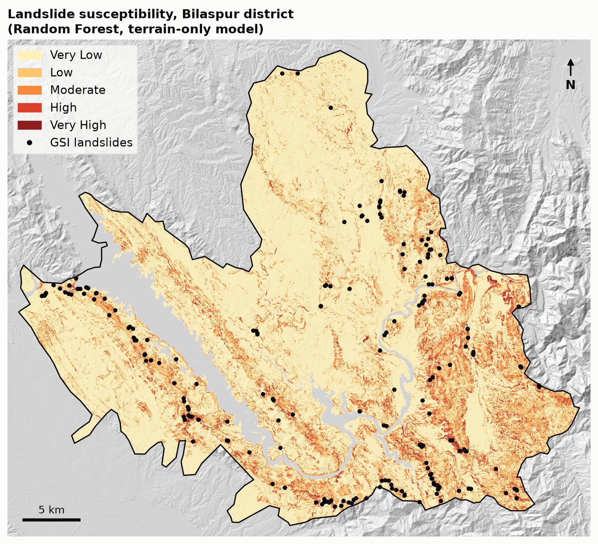

# Landslide Susceptibility Analysis – Bilaspur, Himachal Pradesh

District-wide landslide susceptibility mapping for Bilaspur (H.P., India), comparing an
expert-weighted **MCDA (AHP)** model with **Frequency Ratio**, **Logistic Regression** and
**Random Forest**, validated with **spatial block cross-validation**.



## Key results

| Method | AUC, 2 km spatial CV (terrain only) | AUC, with road distance |
|---|---|---|
| Slope only (baseline) | 0.810 | 0.810 |
| MCDA (AHP weights) | 0.802 | 0.855 |
| Frequency Ratio | 0.827 | 0.902 |
| Logistic Regression | 0.841 | 0.901 |
| **Random Forest** | **0.880** | **0.923** |

- A terrain-only Random Forest reaches **AUC 0.88** on held-out 2 km blocks, **+0.08** over the MCDA baseline.
- Slope, road proximity and vegetation (NDVI) dominate; aspect and stream distance add little.
- In the final map, the High and Very High classes cover **4.5 %** of the district and contain about **70 %** of mapped landslides.

Full write-up: [`docs/Landslide_Susceptibility_Analysis_Bilaspur.pdf`](docs/Landslide_Susceptibility_Analysis_Bilaspur.pdf)

## Data

| Dataset | Source | Use |
|---|---|---|
| Landslide inventory | Geological Survey of India, via [Mendeley Data](https://data.mendeley.com/datasets/mxpg845z62/1) (Chand 2026, CC BY 4.0) | 219 landslide points |
| Copernicus GLO-30 DEM | ESA, via [OpenTopography](https://doi.org/10.5069/G9028PQB) | Elevation, slope, aspect, streams |
| Sentinel-2 L2A | ESA Copernicus, via Google Earth Engine | NDVI (median of 297 scenes, Oct–Nov 2019–24) |
| ESA WorldCover 2021 | ESA, via Google Earth Engine | Water mask |
| Roads | © OpenStreetMap contributors (ODbL) | Distance to road |
| District boundary | GADM 4.1 | Study area |

Raw rasters are not stored in this repository because of their size. The processed
point table (`data/processed/model_data.csv`) is included, so every model can be re-run
without any GIS step.

## Method

1. **Inventory**: GSI points selected by spatial query inside the district boundary (248), duplicates removed → **219** landslides.
2. **Stable points**: 600 random points ≥ 500 m from any landslide and ≥ 200 m apart; 37 on water removed → **563**.
3. **Factors** (30 m grid, UTM 43N): elevation, slope, aspect (as northness/eastness), distance to road, distance to stream (GRASS `r.watershed`), NDVI.
4. **Models**: slope-only baseline, MCDA (AHP), Frequency Ratio, Logistic Regression, Random Forest.
5. **Validation**: AUC with random 5-fold and spatial block CV (2 km and 5 km blocks), each with and without road distance to measure road-corridor survey bias.
6. **Mapping**: Random Forest applied to all 1.2 million district cells; five equal-interval classes.

## Repository structure

```
scripts/
  01_prepare_data.py          clean the sampled table -> model_data.csv
  02_baseline_auc.py          single-factor AUCs
  03_frequency_ratio.py       Frequency Ratio model (5-fold CV)
  04_logistic_regression.py   Logistic Regression + weights
  05_random_forest.py         Random Forest + permutation importance
  06_spatial_cv.py            random vs 2 km / 5 km spatial CV, all methods
  06b_mcda_ahp.py             MCDA (AHP) baseline
  07_susceptibility_map.py    district-wide maps (needs the factor rasters)
  08_figures_charts.py        result charts
  09_figures_maps.py          map figures (needs the factor rasters)
data/processed/               model_data.csv, sampled points, boundary
outputs/                      result tables (CSV) and figures (PNG)
docs/                         project report (PDF)
```

## Run

```bash
pip install -r requirements.txt
python scripts/01_prepare_data.py
python scripts/06_spatial_cv.py      # main comparison table
python scripts/06b_mcda_ahp.py
python scripts/08_figures_charts.py
```

Scripts 07 and 09 need the factor rasters, built in QGIS as described in the report.

## Limitations

- GSI surveys follow roads (54 % of landslides lie on a road cell), so the terrain-only model is the main result.
- Only 7.5 % of inventory records are dated, so NDVI is a multi-year median.
- 30 m terrain data cannot resolve small road cuts; rainfall and lithology are not yet included.

## Author

**Mohammad Danish Siddiqui**, B.Tech Civil Engineering, IIT (ISM) Dhanbad
